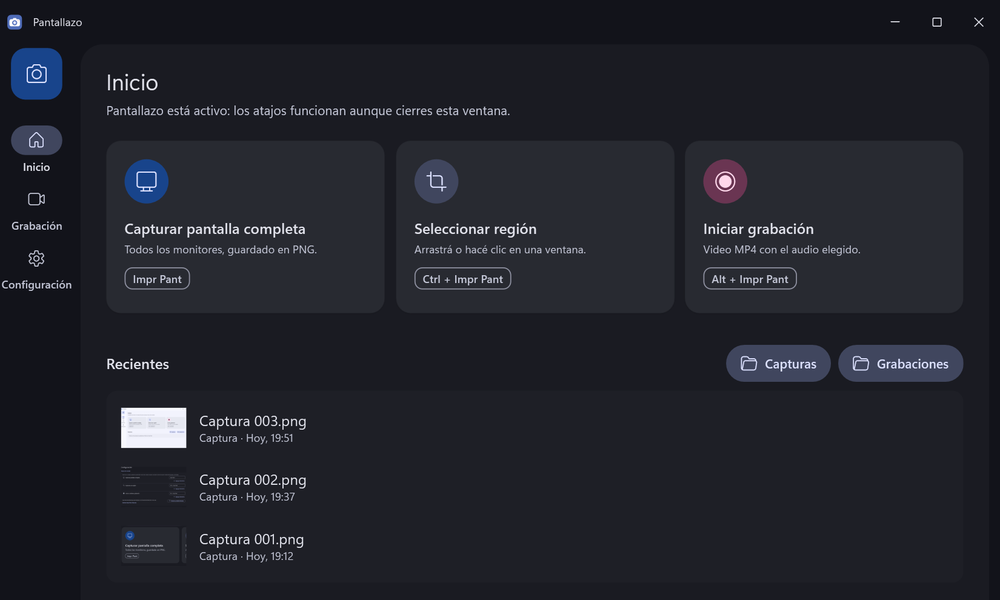
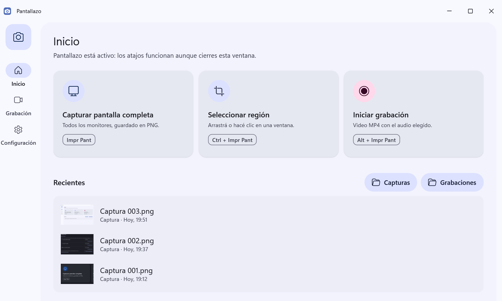
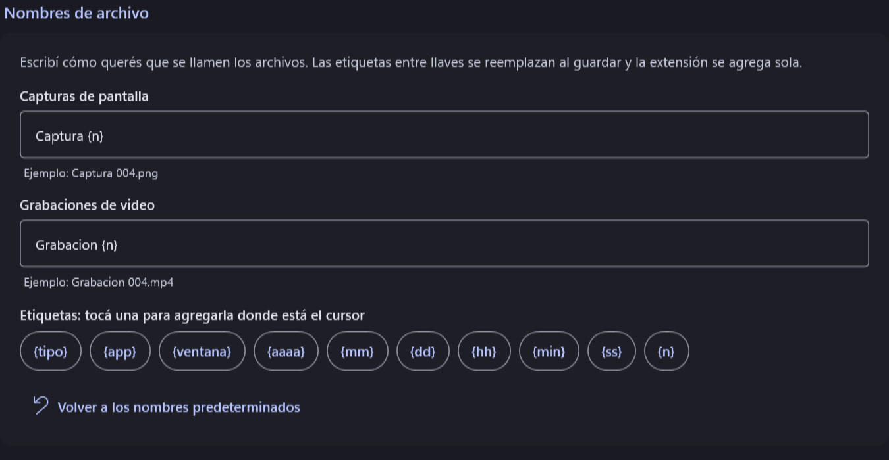
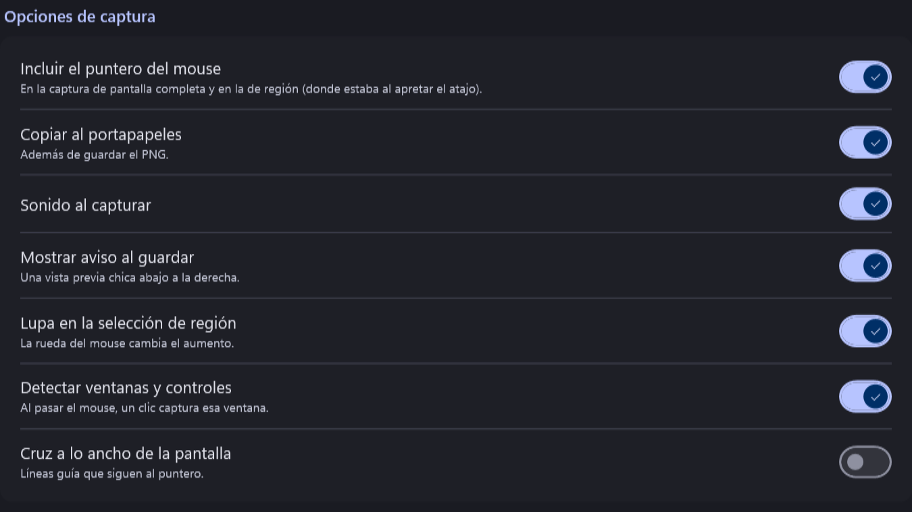

<div align="center">


# Pantallazo

**Capturas y grabación de pantalla para Windows, en tres atajos.**<br>
Una alternativa liviana a ShareX, con interfaz Material You y sin conexión a Internet.

[](https://github.com/niquitoooo/pantallazo/releases/latest)
[](https://github.com/niquitoooo/pantallazo/actions/workflows/compilacion.yml)
[](LICENSE)


[**Descargar**](https://github.com/niquitoooo/pantallazo/releases/latest) ·
[Todas las funciones](docs/FUNCIONES.md) ·
[Cambios](CHANGELOG.md)

</div>

> **English:** Pantallazo is a lightweight, offline screenshot and screen recording tool for Windows 10 and 11,
> inspired by ShareX, with a Material You interface. Full screen (`PrtSc`), region (`Ctrl+PrtSc`) and screen
> recording with system audio and microphones (`Alt+PrtSc`), hardware-accelerated up to 144 fps. The interface is
> in Spanish.

<p align="center">
  
</p>

## Qué hace

| Atajo | Acción | Resultado |
|---|---|---|
| `Impr Pant` | Captura toda la pantalla | PNG con todos los monitores, copiado al portapapeles |
| `Ctrl + Impr Pant` | Captura una región | Selector como el de ShareX: pantalla congelada, lupa con grilla de píxeles y detección de ventanas |
| `Alt + Impr Pant` | Inicia o detiene una grabación | MP4 (H.264 + AAC) con el audio del sistema, micrófonos o los dos |

- **Grabación por la placa de video** (AMD, NVIDIA o Intel), a ritmo constante de 15 a 120 fps, y 144 fps con
  monitores que lleguen. Resolución original, 1080p o 720p. Pausa y reanudación sin cortes.
- **Píldora flotante** con el tiempo, pausa y detener, que no sale en el video.
- **Recientes** con miniaturas de capturas y videos: abrir, renombrar o eliminar sin salir de la app.
- **Nombres de archivo con plantillas**: `{tipo}`, `{app}`, `{ventana}`, fecha, hora y número correlativo.
- **Atajos configurables**, con alternativas y aviso de conflictos con otros programas.
- **Material You**: tema claro, oscuro o del sistema, y el color de Windows o uno propio.
- **Sin conexión ni telemetría.** Nada sale de tu PC.

Cada opción, tecla y valor de fábrica está explicado en [docs/FUNCIONES.md](docs/FUNCIONES.md).

## Instalación

Bajá la última versión desde [**Releases**](https://github.com/niquitoooo/pantallazo/releases/latest):

- **`Pantallazo-x.y.z-instalador.exe`**: se instala solo para tu usuario, sin permisos de administrador.
- **`Pantallazo-x.y.z-win-x64.zip`**: portable; se descomprime en cualquier carpeta y se abre `Pantallazo.exe`.

Ninguno de los dos necesita instalar .NET. Requiere Windows 10 u 11 de 64 bits.

> [!NOTE]
> Los ejecutables no están firmados digitalmente, así que la primera vez Windows SmartScreen puede mostrar
> «Windows protegió su PC». Para seguir: **Más información → Ejecutar de todas formas**.

Si en Windows 11 la tecla `Impr Pant` abre la Herramienta Recortes, Pantallazo lo avisa y ofrece liberarla con un
botón (se puede deshacer desde Configuración).

## Capturas

<table>
  <tr>
    <td></td>
    <td></td>
  </tr>
  <tr>
    <td align="center">Tema claro</td>
    <td align="center">Nombres de archivo con plantillas</td>
  </tr>
  <tr>
    <td colspan="2"></td>
  </tr>
  <tr>
    <td colspan="2" align="center">Opciones de captura</td>
  </tr>
</table>

## Compilar desde el código

Requisitos: Windows 10 u 11 y el [SDK de .NET 10](https://dotnet.microsoft.com/download/dotnet/10.0).

```powershell
git clone https://github.com/niquitoooo/pantallazo.git
cd pantallazo
dotnet build Pantallazo.slnx -c Release
dotnet test Pantallazo.slnx -c Release
```

Para armar el instalador y el portable:

```powershell
.\scripts\publish.ps1
```

Deja la app autocontenida en `dist\Pantallazo\` y el instalador y el zip en `dist\`. Para el instalador baja
Inno Setup como paquete NuGet a `.tools\`, sin instalar nada en Windows. Con `-SinInstalador` arma solo el zip.

Cada versión se publica sola: al subir una etiqueta `vX.Y.Z`, GitHub Actions compila, corre los tests y sube el
instalador y el portable a Releases con las notas de [CHANGELOG.md](CHANGELOG.md).

### Estructura

| Carpeta | Contenido |
|---|---|
| `src/Pantallazo` | App WPF: `Core` (lógica pura y testeable), `Hotkeys`, `Capture`, `Region`, `Services`, `Theming` (Material 3 propio), `Views` |
| `src/Pantallazo.Recording` | Motor de grabación: Windows Graphics Capture → Direct3D 11 → Media Foundation, y audio WASAPI mezclado ([detalles](src/Pantallazo.Recording/README.md)) |
| `tests` | Tests automáticos (xUnit) |
| `tools/RecHarness` | Consola para probar el motor de grabación en hardware real |
| `installer` | Script de Inno Setup |
| `docs` | [Funciones](docs/FUNCIONES.md), [diseño](docs/DISENO.md), [pruebas](docs/PRUEBAS.md) y [licencias](docs/LICENCIAS.md) |

## Privacidad

Pantallazo funciona completamente sin Internet: no tiene telemetría, no busca actualizaciones y no envía nada.
La configuración queda en `%APPDATA%\Pantallazo` y los registros (14 días) en `%LOCALAPPDATA%\Pantallazo\logs`.

## Créditos

El comportamiento de las capturas y del selector de región se tomó de [ShareX](https://github.com/ShareX/ShareX).
Usa [Vortice.Windows](https://github.com/amerkoleci/Vortice.Windows) para Direct3D 11 y Media Foundation, y
[NAudio](https://github.com/naudio/NAudio) para el audio. El instalador se arma con [Inno Setup](https://jrsoftware.org/isinfo.php).

## Licencia

[GPL v3](LICENSE). Detalle de dependencias en [docs/LICENCIAS.md](docs/LICENCIAS.md).
